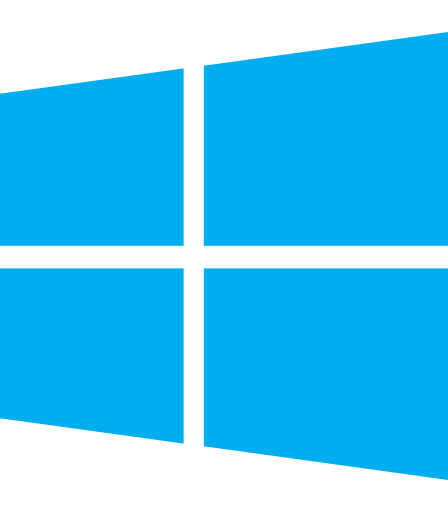
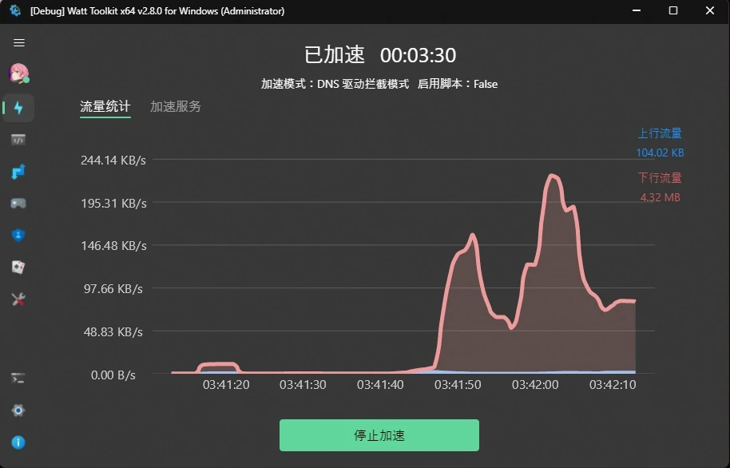
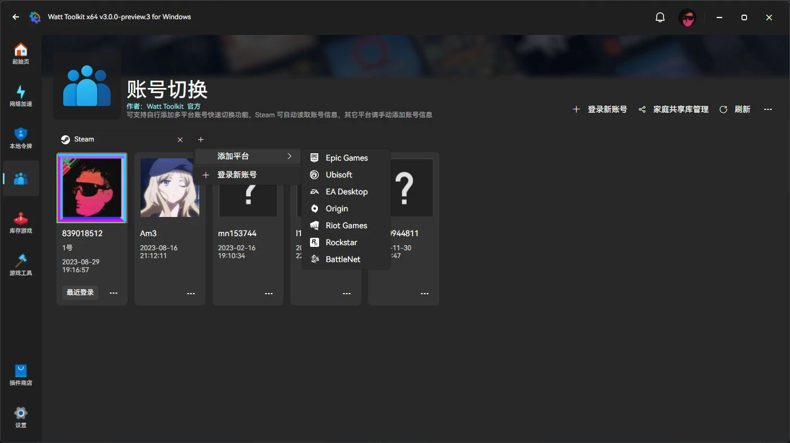
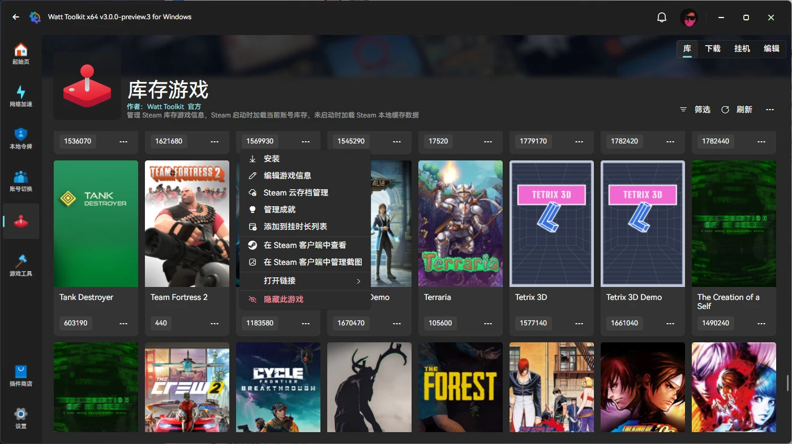
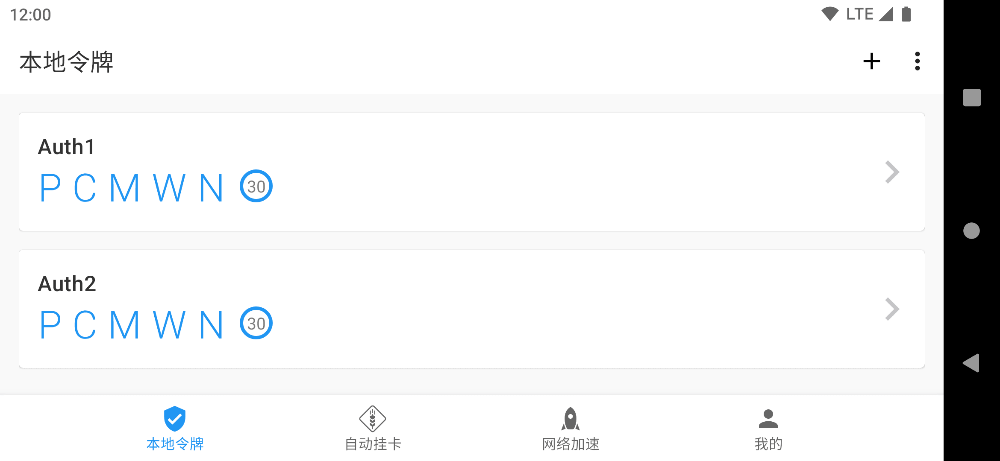

<h1 align="center">Watt Toolkit 🧰 (原名 Steam++)</h1>

[English](./README.en.md) | 简体中文

「Watt Toolkit」是一个开源跨平台的多功能游戏工具箱，此工具的大部分功能都是需要您下载安装 Steam 才能使用。
 

## 🚀 下载渠道
- 
- 
- [软件官网](https://steampp.net)
- [GitHub 发行版](https://github.com/BeyondDimension/SteamTools/releases)
- [码云 发行版](https://gitee.com/rmbgame/SteamTools/releases)
- [Arch 用户仓库](https://aur.archlinux.org/packages/watt-toolkit-bin)（当前 Release 构建）
- [Arch 用户仓库 dev](https://aur.archlinux.org/packages/watt-toolkit-git)（拉取最新源码构建，也许会构建失败）

## ⬇️ [下载指南](./doc/download-guide.md)
详见 [./doc/download-guide.md](./doc/download-guide.md)  

## ✨ 功能
全新的 3.0 版本，支持自定义插件功能，以下功能为下载时自带的默认插件，可以自行删除或禁用。
1. 网络加速     
	- 使用 [YARP.ReverseProxy](https://github.com/microsoft/reverse-proxy) 开源项目进行本地反代来支持更快的访问游戏网站。
	- 通过加速服务拦截网络请求将一些 JS 脚本注入在网页中，提供类似网页插件的功能。
3. 账号切换   
	- 快速切换已在当前 PC 上登录过的 Steam、Epic、Uplay 等等多平台账号，与管理 Steam 家庭共享库排序及禁用等功能。
4. 库存游戏   
	- 直接管理你的 Steam 游戏库存，可以编辑游戏名称和[自定义封面](https://www.steamgriddb.com)。
	- 监控 Steam 游戏下载进度实现 Steam 游戏下载完成定时关机功能。
	- 模拟运行 Steam 游戏，让您不用安装和下载对应的游戏也能挂游玩时间和掉落 Steam 卡片
	- 自助管理 Steam 游戏云存档，随时删除和上传自定义的存档文件至 Steam 云。
	- 解锁以及反解锁 Steam 游戏成就。
5. 本地令牌     
	- 让您的手机令牌统一保存在电脑中、支持通用HOTP、TOTP、Steam、Google 等令牌导入。
	- 支持 Steam 登录账号自定绑定生成令牌、支持 Steam 批量确认交易功能。
6. ~~自动挂卡(新版本开发中)~~     
	- ~~集成 [ArchiSteamFarm](https://github.com/JustArchiNET/ArchiSteamFarm) 在应用内提供 挂机掉落 Steam 集换式卡牌 等功能。~~
7. 游戏工具 
	- 强制游戏窗口使用无边框窗口化、更多功能待开发。

## 🖥 支持的操作系统
- Windows 11
- Windows 10 版本 1809（OS 内部版本 17763）或更高版本
- macOS 10.15 或更高版本
- Ubuntu 20.04 或更高版本
- Debian 11 或更高版本
- Fedora 37 或更高版本
- Deepin(UOS) 20 或更高版本
- ~~iOS 11 或更高版本~~（开发中…）
- Android 5.0(API 21) 或更高版本

## 🧩 截图

 

 

 
 
<!---->

## 从移动端 Steam App 导入令牌指南
- [Android 添加本地令牌（Xposed）](https://github.com/BeyondDimension/SteamTools/issues/2276)
- [iOS 添加本地令牌（无需越狱/网络抓包）](https://github.com/BeyondDimension/SteamTools/issues/2129)
- [iOS 添加本地令牌（无需越狱/iTunes 备份）](https://github.com/BeyondDimension/SteamTools/issues/299)
- [iOS 添加本地令牌（需越狱）](https://github.com/BeyondDimension/SteamTools/issues/95)

## 🌏 路线图
查看这个 [milestones](https://github.com/BeyondDimension/SteamTools/milestones) 来了解我们下一步的开发计划，并随时提出问题。

## ⌨️ 开发环境
[Visual Studio 2026](https://visualstudio.microsoft.com/zh-hans/vs)     
[JetBrains Rider](https://www.jetbrains.com/rider)  
[Visual Studio Code](https://code.visualstudio.com)  
[OpenJDK 17](https://learn.microsoft.com/zh-cn/java/openjdk/download#openjdk-17)  
[Android Studio Electric Eel 或更高版本](https://developer.android.google.cn/studio)  
[Xcode 26 或更高版本](https://developer.apple.com/xcode)  

## 🏗️ [项目结构](./src/README.md)
详见&nbsp;&nbsp;[./src/README.md](./src/README.md)  

## 🧑‍💼 加入我们
- [.NET/C# 高级软件工程师（客户端方向）](https://www.zhipin.com/job_detail/b271a34a3efeb84c1XJ_2dW6ElVT.html)
- [.NET/C# 高级软件工程师](https://www.zhipin.com/job_detail/0164142566ff52d71XJ_2dW7GVVW.html)

<!--
- [.NET/C# 软件工程师](https://www.zhipin.com/job_detail/80c0ad0f424e2ea61XJ_2t6-GVVZ.html)
- [高级 Web 前端工程师](https://www.zhipin.com/job_detail/e59317c527f3f49e1XJ92d24FVRV.html)
-->

## 📄 [开源代码库](./doc/open-source-library.md)  
详见&nbsp;&nbsp;[./doc/open-source-library.md](./doc/open-source-library.md)  
